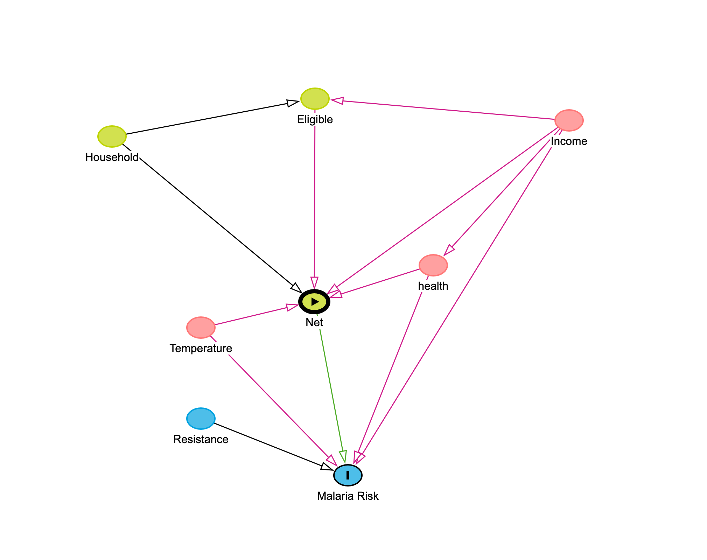

::: {.callout-important}
## Course information

- Course: MATH 4400/6400, Fall 2026
- Instructor: Dr. Jishan Ahmed, Department of Mathematics, Weber State University
- Submit: your completed `.qmd` file and the rendered `.html` file
- Total: **120 points**
:::

# Overview

**Causal question:** Does using a mosquito net, compared with not using a net, reduce malaria risk?

You will analyze **simulated observational data** on households. Households were not randomly assigned to use nets. Therefore, differences in malaria risk between net users and nonusers may reflect both the effect of nets and differences in household characteristics.

Your goal is to complete five steps:

1. Specify a causal question.
2. Draw our assumptions using a causal diagram.
3. Model our assumptions.
4. Diagnose our models.
5. Estimate the causal effect.

Download `net_data.csv` from Canvas and save it in the same folder as this Quarto file.

Relevant variables include:

- `net`: Mosquito net use
- `malaria_risk`: Malaria risk score (0–100)
- `income`: Weekly income
- `health`: Health score (0–100)
- `temperature`: Nighttime temperature
- `household`: Household size
- `eligible`: Free-net program eligibility
- `resistance`: Insecticide resistance

**Note:** These are simulated observational data, not results of a randomized experiment. The risk score is not a binary malaria diagnosis.

## 1. Load packages and inspect the data (4 points)

Install any missing packages in the R console before rendering. Load the packages below and import `net_data.csv`. Examine the data structure, missing values, and counts of net users and nonusers. Check how `net` is coded before modeling.

```{r}
#| label: q01-data
library(tidyverse)
library(broom)
library(dplyr)

net_data <- read_csv("net_data.csv")

# Your code here
```
```{r}
#examine data structure
glimpse(net_data)

#checking for missing values
net_data %>% 
  map(is.na) %>% 
  map(sum)

#counting values in 'net'
net_data %>%
  count(net)

head(net_data)
```

**Reflection:** How many observations are there? How many used a net? What does `malaria_risk` measure?

**Your answer:** There are 1752 observations with no missing values. 454 used a net and 1298 did not. 'malaria_risk' is a risk score from 0-100 that indicates how much the observation was at risk of contracting malaria. It doesn't seem clear whether this is a score calculated from the other variables in the dataframe, or whether this is assigned outside the system. 

# Step 1: Specify a causal question (8 points)

## 2. Define the treatment, outcome, and causal estimand (4 points)

State your causal question precisely. Identify (a) the population, (b) the treatment and comparison groups, (c) the outcome and its units, and (d) the time horizon (one year). Define the **average treatment effect (ATE)** in words and using the potential-outcomes expression:

$$ATE = E[Y(1)-Y(0)].$$

**Your answer:**
a) The population is anyone in the target location who is at risk of malaria and could potentially use a mosquito net. 
b) Treatment group: Individuals who use a mosquito net
   Comparison group: Individuals who do not use a mosquito net
c) Outcome variable: malaria_risk
   Units: A risk score ranging from 0-100
d) Time Horizon: One year, estimate the effects of a mosquito net over the course of one year

The ATE is the difference in the average malaria_risk score between those who used a net and those who didn't, where y=1 is those who did and y=0 is those who didn't. The ATE would then look like the model above: ATE = E[malaria_risk value of net users] - E[malaria_risk value of non-net users] = E[Y(1)] - E[Y(0)] = E[Y(1)-Y(0)] 

## 3. Describe the observed association (4 points)

Create a density plot or boxplot of `malaria_risk` by `net` and a table of mean malaria risk in each group. Calculate the unadjusted difference as **mean among net users minus mean among nonusers**.

```{r}
#| label: q03-unadjusted
# Your code here

# Boxplot
ggplot(net_data, aes(x = net, y = malaria_risk)) +
  geom_boxplot() +
  labs(
    title = "Malaria Risk by Mosquito Net Use",
    x = "Mosquito Net Use (0 = No, 1 = Yes)",
    y = "Malaria Risk Score (0–100)"
  ) +
  theme_minimal()

# Table of mean malaria risk 
mean_table <- net_data %>%
  group_by(net) %>%
  summarise(
    n = sum(!is.na(malaria_risk)),
    mean_malaria_risk = mean(malaria_risk, na.rm = TRUE)
  )

print(mean_table)

mean_users <- mean(net_data$malaria_risk[net_data$net == 1], na.rm = TRUE)

mean_nonusers <- mean(net_data$malaria_risk[net_data$net == 0], na.rm = TRUE)

unadjusted_difference <- mean_users - mean_nonusers

print(unadjusted_difference)
```

**Reflection:** Which group has lower observed risk? Why might this difference fail to represent a causal effect?

**Your answer:**
From observation, it is easy to identify that there is some type of correlation between using a net and a lower malaria risk. By looking at the box plot, when using a mosquito net the median is substantially lower than the median without using a mosquito net. Additionally, the unadjusted difference gave a value of roughly -16, which means that people who use the mosquito net have on average a malaria score that is 16 less than those who do not use the net. 

This is not conclusive enough to say that mosquito nets have a causal relationship with malaria risk. There are many other variables that can also influence malaria risk that are not being addressed here. Income, health, household, temperature, are all variables that can also influence malaria risk. At this point we cannot assume that mosquito nets are decreasing malaria risk just because the median and unadjusted difference is lower. 

# Step 2: Draw our assumptions using a causal diagram (12 points)

## 4. Construct a directed acyclic graph (DAG) using DAGitty (7 points)

Open [DAGitty](https://dagitty.net/dags.html) and create a causal DAG with `net` as the exposure and `malaria_risk` as the outcome.

Include the following proposed causal relationships:

- `malaria_risk` is affected by `net`, `income`, `health`, `temperature`, and `resistance`.
- `net` is affected by `income`, `health`, `temperature`, `eligible`, and `household`.
- `eligible` is affected by `income` and `household`.
- `health` is affected by `income`.

**Instructions:**

1. Create the DAG in DAGitty using the relationships listed above. Include all eight variables.
2. Identify `net` as the exposure and `malaria_risk` as the outcome.
3. Export your DAG as a PNG image (or take a screenshot) and save it as `malaria_dag.png` in the same folder as your Quarto file.
4. Insert the image into your Quarto report using the following Markdown syntax (remove the leading `#` to display it):





**Note:** Treat the arrows as causal assumptions, not relationships proven by the data.

## 5. Identify confounding and an adjustment set (5 points)

Use DAGitty to identify a minimal sufficient adjustment set for estimating the total causal effect of `net` on `malaria_risk`.

**Instructions:**

1. Use DAGitty's **Adjustment (total effect)** feature to identify a minimal sufficient adjustment set.
2. Report the variables in the adjustment set.
3. Explain why these variables need to be adjusted for.
4. Explain why some variables in your DAG do not need to be included in the minimal sufficient adjustment set.

**Your answer:**
1. They are the pink variables in the DAG above. 
2. The adjustment set variables are income, temperature, and health
3. These variables need to be adjusted for because they are confounding variables that open backdoors to estimating the effect of using a net on the malaria_risk score
4. Other variables like eligible, household and resistance do not need to be included in the minimal sufficient adjustment set because they are either mediating variables (like eligible) or are variables that have an effect on net use, which isn't important in the relationship we are trying to examine. 
# Step 3: Model our assumptions (12 points)

## 6. Estimate propensity scores (6 points)

Fit a **logistic regression** that predicts net use from the minimal adjustment set identified in Step 2. Calculate each household's estimated propensity score, $\hat e(X_i)=P(A_i=1\mid X_i)$, where $A_i=1$ indicates net use. Make sure your treatment coding matches this definition. Show a summary of the propensity scores and their range by treatment group.

```{r}
#| label: q06-propensity
# Your code here
#creating logistic regression model using net as the outcome variable with confounding parameters income, health and temperature
log_reg <- glm(
  net ~ income + health + temperature, 
  data=net_data,
  family=binomial(link = 'logit')
)
```
```{r}
#calculating propensity scores ('response' calculates propensity scores)
prop_scores <- predict(
  log_reg, type = 'response')

#adding propensity scores to df
net_data <- net_data %>% 
  mutate(prop_scores)

#displaying summary and range by treatment group 
net_data %>% 
  group_by(net) %>% 
  summarize(
    n = n(),
    mean = mean(prop_scores),
    median = median(prop_scores),
    sd = sd(prop_scores),
    min = min(prop_scores),
    max = max(prop_scores)
    
  )

```


**Reflection:** What does a propensity score represent? Is it a predicted malaria risk?

**Your answer:**
The propensity score is the probability of a particular observation getting the treatment. No, it is not the predicted malaria risk. It is simply the probability of that household to be in the group that used a net. 

## 7. Calculate inverse probability weights (6 points)

Compute **ATE inverse probability weights (IPW)**:

$$w_i = \frac{A_i}{\hat e(X_i)}+\frac{1-A_i}{1-\hat e(X_i)}.$$

Store the propensity scores and weights in a new data frame. Show the first six observations with treatment status, propensity score, and weight. Check that probabilities are strictly between 0 and 1 before calculating weights.

```{r}
#| label: q07-weights
# Your code here
#verify propensity scores are between 0 and 1: 
all(prop_scores > 0 & prop_scores < 1)

#calculating inverse probability weights from propensity scores and creating a new column of them called ip_weights for new data frame ip_data
ip_data <- net_data %>% 
  mutate( ip_weights = if_else(
    net == TRUE,
    1 / prop_scores, 
    1 / (1 - prop_scores)
  )
)

#showing first 6 observations
ip_data %>% 
  dplyr::select(net, prop_scores, ip_weights) %>% 
  head(6)
```

**Reflection:** Why does an observation with a low probability of receiving its observed treatment receive a larger weight?

**Your answer:**
Because an observation with a low probability of receiving the treatment that did in fact receive the treatment is an observation whose outcome (having used a net) was not predicted by our model. We want to give observations like these more weight so that the imbalance between treatment and non-treatment groups is corrected. Basically we are removing the effect of potentially confounding variables. In our case those variables are health, temperature and income. We are balancing the differences between high and low income groups, for instance, and the potential impact that might have on having used a net or not. We are doing the same thing with temperature and health. 

# Step 4: Diagnose our models (10 points)

## 8. Check propensity score overlap (5 points)

Plot propensity score distributions for net users and nonusers using density plots or histograms. Clearly distinguish the two groups. Discuss whether their propensity scores overlap and identify any regions with limited overlap.

```{r}
#| label: q08-overlap
# Your code here
#creating overlapping density plot
ggplot(ip_data, aes(x=prop_scores, fill=net)) +
  geom_density(alpha=0.4) + #transparency of curve
  scale_fill_manual(values = c("FALSE" = "steelblue", "TRUE" = "coral")) + #color scheme
  labs( #labels
      title = "Propensity Score Distribution", 
      x = "Propensity Score",
      y = "Density",
      fill = "Net Use"
  ) + 
  theme_bw()
```

**Reflection:** Why is overlap important when estimating the average treatment effect?

**Your answer:**
In our case, we can see that net-users do end up with higher propensity scores on the whole than non-net users. But there is also a decent amount of overlap, and the scores centers for each group are not enormously different. This indicates that there are a decent number of observations with similar propensity scores in both groups. Overlap becomes important for estimating ATE because it means we can make better comparisons between the households that used a net and those who didn't. Essentially it allows us to create a kind of artificial counter factual (because each household can't both use a net and not use a net, so we can't directly compare outcomes that way.) But we can compare outcomes of observations with similar propensity scores. It doesn't mean the households have identical characteristics, necessarily, but with a similar propensity score, they have a similar overall probability of having appeared in the treatment group. 

## 9. Examine inverse probability weights (5 points)

Plot a histogram of the inverse probability weights. Report their minimum, median, maximum, and 99th percentile. Identify whether any households receive much larger weights than most others.

```{r}
#| label: q09-weight-diagnostics
# Your code here
ggplot(ip_data, aes(x = ip_weights)) +
  geom_histogram(bins = 30, color = "black", fill = "steelblue") +
  labs(
    title = "Distribution of Inverse Probability Weights",
    x = "Inverse Probability Weight",
    y = "Frequency"
  ) +
  theme_minimal()

quantile(
  ip_data$ip_weights,
  probs = c(0, 0.50, 0.99, 1),
  na.rm = TRUE
)

# boxplot to determine if there are any outliers, and where the inverse probablity weights are sitting
boxplot(
  ip_data$ip_weights,
  main = "Boxplot of Inverse Probability Weights",
  ylab = "Inverse Probability Weight",
  col = "lightblue"
)

```

**Reflection:** Why can extreme weights make a causal effect estimate unstable? What might you investigate if you find unusually large weights?

**Your answer:**

Extreme weights will cause an unbalanced effect on an estimate. It will cause those houses to have an disproportionately large influence compared to the median. In the boxplot you can see the large difference between houses with large weights, and the median. I would want to investigate why these houses have much higher weights than others. Are there any characteristics they have that other houses do not have? 

# Step 5: Estimate the causal effect (10 points)

## 10. Fit the weighted outcome model (6 points)

Fit a weighted linear regression of `malaria_risk` on `net` using the inverse probability weights. Report the estimated coefficient for net use and compare it with the unadjusted difference from Step 1. Interpret the **sign, magnitude, and units** of the weighted estimate. You are not required to calculate a confidence interval.

```{r}
#| label: q10-effect
# Your code here

ipw_model <- lm(
  malaria_risk ~ net,
  data = ip_data,
  weights = ip_weights
)

# Display regression results
summary(ipw_model)

# Extract the coefficient for net use
coef(ipw_model)["netTRUE"]

# Compare with unadjusted difference from 1
unadjusted_diff <- with(
  ip_data,
  mean(malaria_risk[net == TRUE], na.rm = TRUE) -
    mean(malaria_risk[net == FALSE], na.rm = TRUE)
)

# Weighted estimate
weighted_estimate <- coef(ipw_model)["netTRUE"]

# Compare estimates
c(
  Unadjusted_Difference = unadjusted_diff,
  Weighted_Estimate = weighted_estimate
)
```

**Reflection:** How did the estimated effect change after weighting? What does this suggest about confounding in the original comparison?

**Your answer:**
First, I would like to note that both weighted and not weighted are in the negative, which does suggest that net users have a lower malaria risk than non-users. After weighting the difference actually increases by roughly 4. This does suggest that net users and non-users may have confounded the original comparison. Adjusting for this in the weighted difference would reduce the effect of confounding. 

## 11. Interpret the result and its limitations (4 points)

In 2–3 sentences, answer the following:

1. What is your estimated ATE, in malaria-risk-score points?
2. Does the estimate suggest a protective or harmful effect of net use?
3. Could an unmeasured confounder change your conclusion? Explain briefly.

**Your answer:**

# Reflection (6 points)

Answer each question in **1–2 sentences**.

**1. What did you do well on this assignment?**

**Your answer:**

**2. What was the most challenging part of this assignment?**

**Your answer:**

**3. What would have improved your experience with this assignment?**

**Your answer:**

**4. What do you still need help with?**

**Your answer:**

# Render and submit (3 points)

Save your Quarto document, restart your R session, render the document from beginning to end, and confirm that the HTML contains all code output, plots, and written responses. Submit **both** the `.qmd` and rendered `.html` files. Keep `net_data.csv` and `malaria_dag.png` in the same folder while rendering.

#### Quick Render Check

Run the code below and render your Quarto document.  
If the plot appears in the HTML file, your document is rendering R output correctly.

```{r}
#| label: render-check
#| echo: true

plot(
  cars,
  main = "Quarto Render Check",
  xlab = "Speed",
  ylab = "Stopping Distance"
)
```

# AI use disclosure

State whether you used AI tools. If yes, name the tool(s), explain what you used them for, and describe how you verified the results. Your submitted code and interpretations must reflect your own understanding.

**Your disclosure:**

# Group dynamics

If working in a group, distribute the work equitably. Every group member should be able to explain the DAG, weighting, diagnostics, and causal interpretation.

```{r}
#| label: session
sessionInfo()
```
